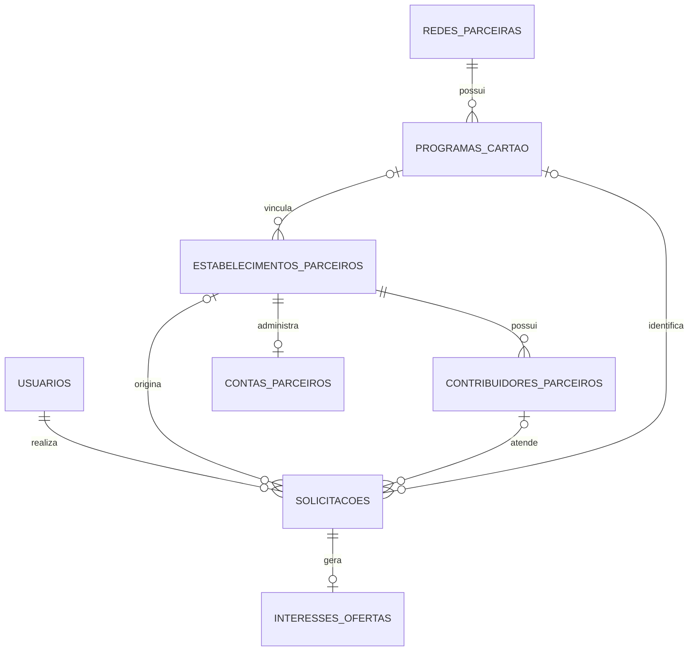

# Modelo relacional

Usuários: CPF e e-mail únicos. Solicitações: usuário, modalidade, unidade, programa, atendente, status e data. A chave ativa única evita duplicação entre unidades do mesmo programa. O hash do código privado protege a consulta; a localização do cliente não é persistida pelo aplicativo. Colaboradores DM e catálogo de cartões são tabelas independentes. Modelos completos em backend/app/models.

Uma unidade está vinculada a no máximo um programa neste protótipo. A DM deve confirmar a abrangência contratual de cada programa antes de cadastrar unidades reais.
